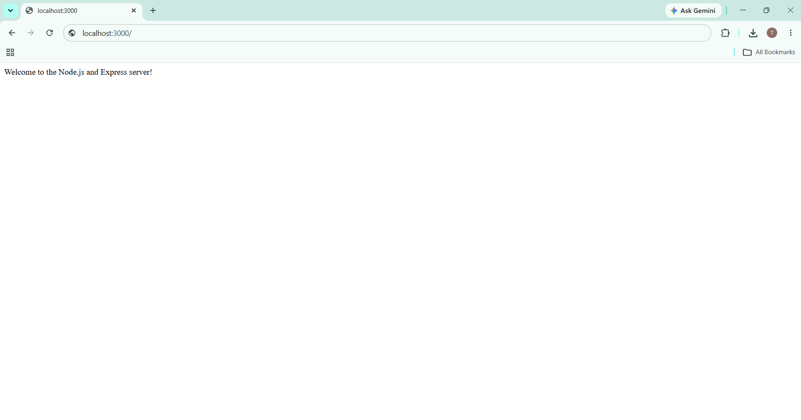
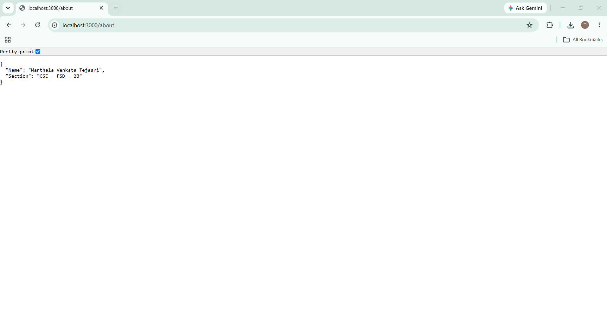
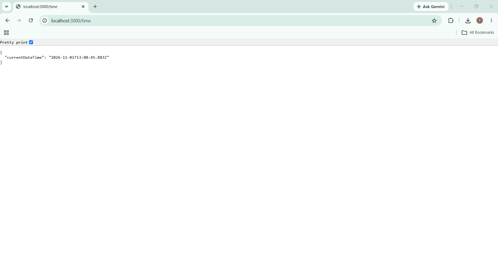
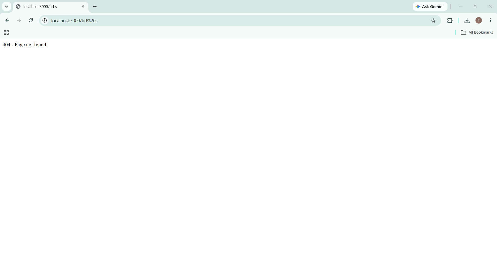

# Lab 1: Node.js and Express server

**Course:** Backend Development Fundamentals (ADBMS)  
**Name:** Marthala Venkata Tejasri  
**Registration Number:** 252U1R7062 
**Section:** CSE - FSD - 2B

## Live link


## Objective

To create a Node.js project, understand `package.json`, build a basic server using Node.js' built-in `http` module, and then build an Express server with routes and 404 handling.

## Technologies used

- Node.js
- Express.js
- npm

## Project structure

```text
lab-01/
├── screenshots/
│   ├── home.png
│   ├── about.png
│   └── time.png
│   └── not-found.png
├── .gitignore
├── package.json
├── http-server.js
├── server.js
└── README.md
```

## How to install and run

### 1. Install dependencies

Make sure Node.js and npm are installed. Open a terminal in this folder and run:

```bash
npm install
```

### 2. Run the basic Node.js HTTP server

```bash
npm run start:http
```

Open `http://localhost:3000` in your browser. The server displays `Hello`.

Stop this server before starting the Express server because both use port `3000`.

### 3. Run the Express server

```bash
npm start
```

The Express server runs at:

```text
http://localhost:3000
```

No environment variables are required for local use. The server uses port `3000` by default and uses `PORT` if it is provided by the hosting environment.

## package.json explanation

| Field | Description |
|---|---|
| `name` | Name of the project/package. |
| `version` | Current version of the project. |
| `description` | Short description of the project. |
| `main` | Main entry file of the application. |
| `scripts` | Commands that can be run using npm. |
| `keywords` | Search terms related to the project. |
| `author` | Author of the project. |
| `license` | License under which the project is shared. |
| `dependencies` | External packages required by the project, such as Express. |

`node_modules` contains the installed package files. `package.json` records project metadata, scripts, and dependency information. Do not commit `node_modules`; it can be recreated using `npm install`.

## Key points

| Method | Path | Description | Expected status |
|---|---|---|---|
| GET | `/` | Displays a welcome message. | 200 OK |
| GET | `/about` | Returns the name and section as JSON. | 200 OK |
| GET | `/time` | Returns the current server date and time as JSON. | 200 OK |
| GET | Any unknown path | Displays a not-found message. | 404 Not Found |

## Screenshots


### Home route



### About route



### Time route



### 404 route



## Notes

- The basic server in `http-server.js` uses Node.js' built-in `http` module.
- The Express server in `server.js` uses `express()` and `app.listen()`.
- The request logger prints the HTTP method, requested path, and response status code in the terminal.
- Replace the name, registration number, and section placeholders before submission.
- Add the real screenshots before submitting. The image links above will display the images once the files are added.
- `node_modules` and `.env` are excluded through `.gitignore`.


