# Lab 2: SQLite database and CRUD routes

**Name:** Marthala Venkata Tejasri
**Registration Number:** 252U1R7062 
**Section:** CSE - FSD - 2B

## Live Deployment

https://adbms-lab-02.onrender.com/

## Test Endpoints

GET All Books: https://adbms-lab-02.onrender.com/books/

GET Book by ID: https://adbms-lab-02.onrender.com/books/1/

## The API is deployed and tested successfully on Render.

## How to run

Run these commands from the `lab-02` folder:

```bash
npm install
npm run dev
```

The server runs locally on port 3000. On a hosting platform it uses the `PORT` environment variable when provided.

## Database

Database file: `database/books.db`  
Table: `book` (id, title, author, price, pages)

The included database contains 10 sample rows. To recreate/populate the database using SQLite CLI, first delete the existing `database/books.db`, then run:

```bash
sqlite3 database/books.db < database/books.sql
```

## Endpoints

| Method | Path | Description |
|---|---|---|
| GET | `/books/` | Get all books |
| GET | `/books/:bookId/` | Get one book by ID |
| POST | `/books/` | Add a book |
| PUT | `/books/:bookId/` | Update a book |
| DELETE | `/books/:bookId/` | Delete a book |

POST and PUT JSON body example:

```json
{
  "title": "Sample Book",
  "author": "Sample Author",
  "price": 350,
  "pages": 200
}
```

## Screenshots


- `get-all-books-01.png`
- `get-all-books-02.png`
- `get-all-books-verify.png`
- `get-single-book.png`
- `post-book-01.png`
- `post-book-verify.png`
- `update-book-01.png`
- `update-verify.png`
- `delete-book-01.png`
- `delete-book-02.png`
- `delete-verify.png`
- `sqlite-table.png`


## To get all books

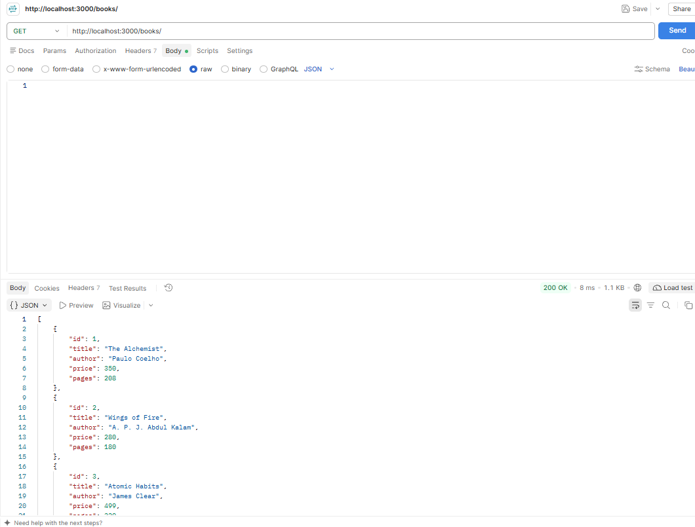
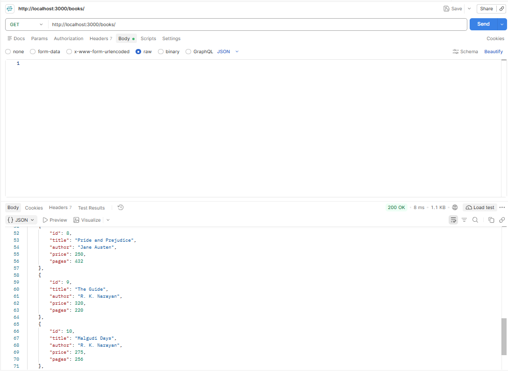
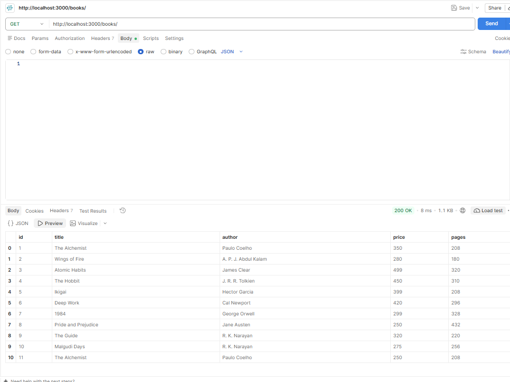


## To get a single book by bookId

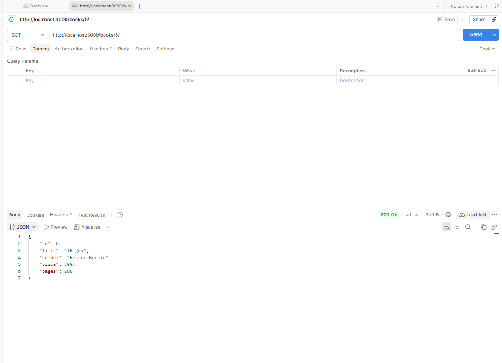


## To create a new book

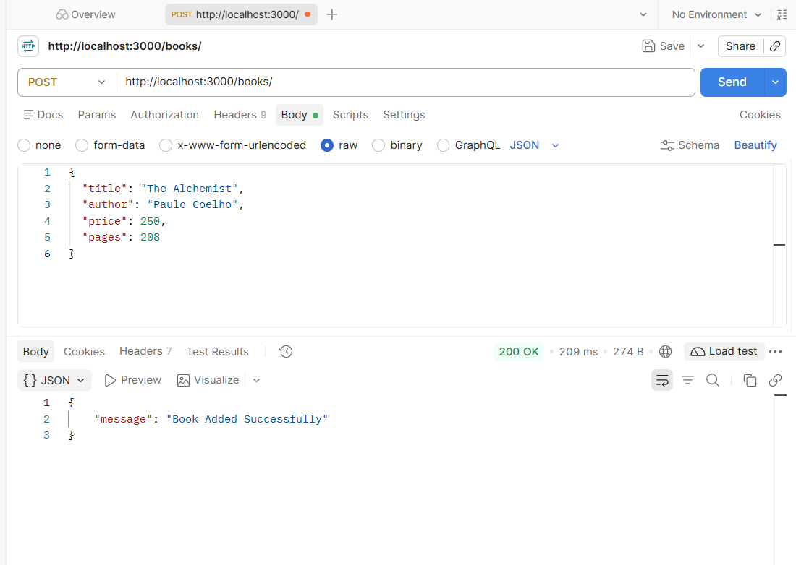
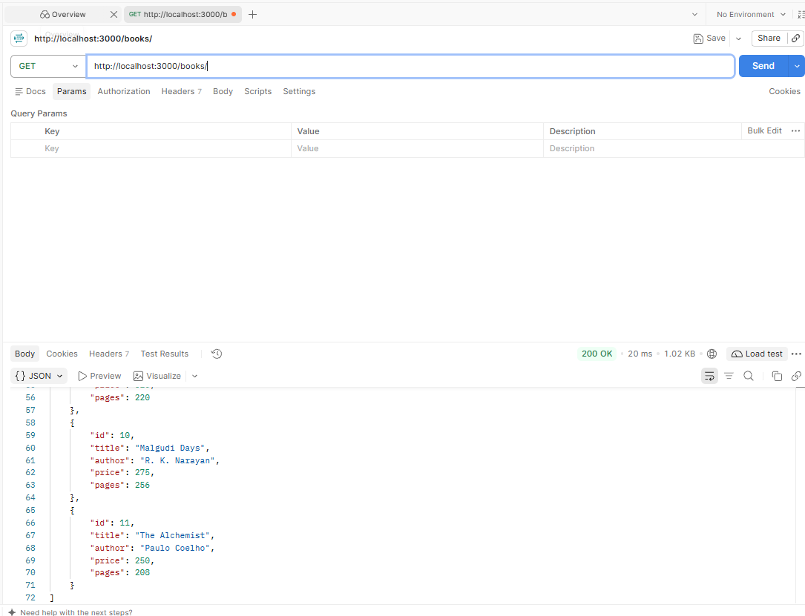


## To update any book

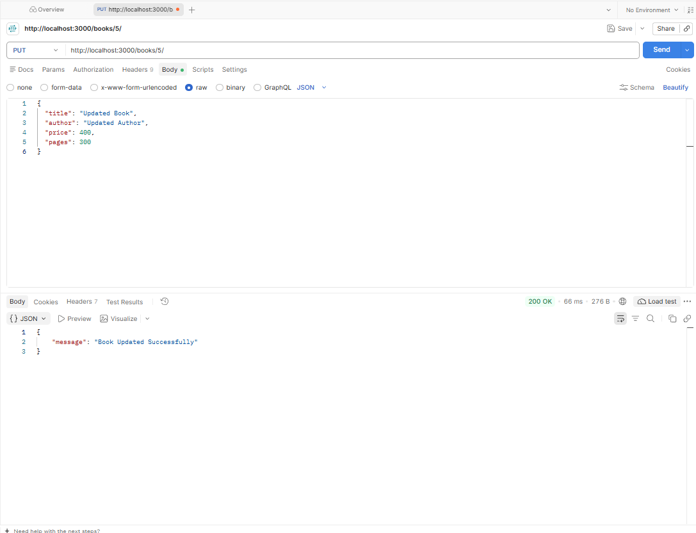
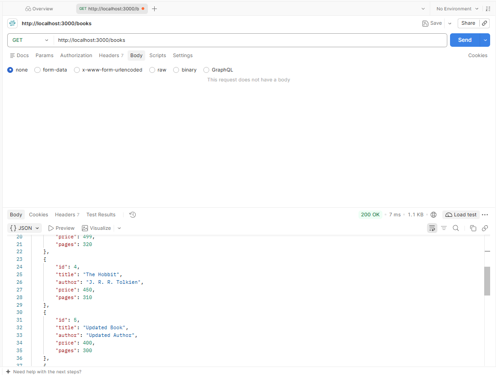

## To delete any book

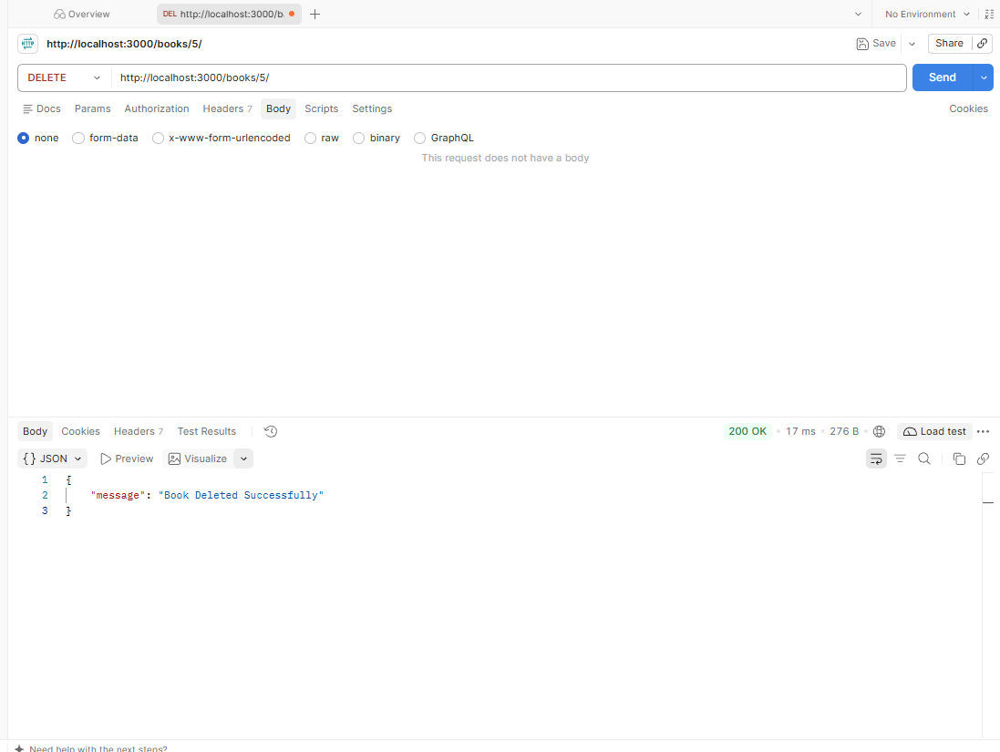
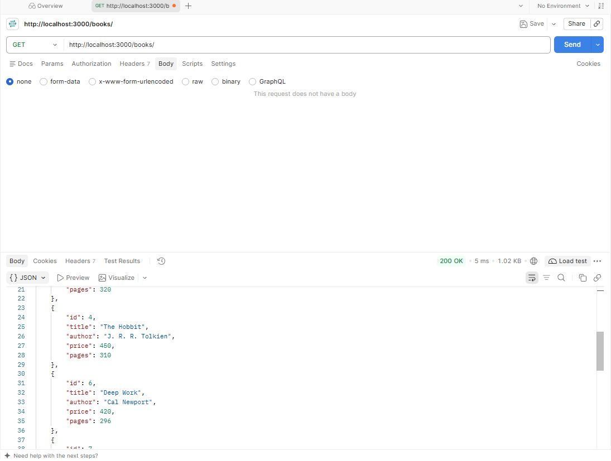
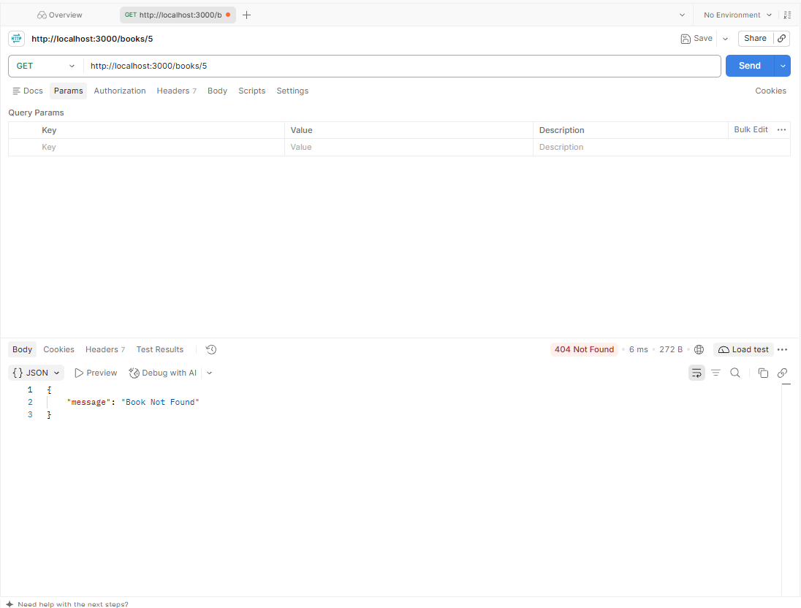

## The sqlite database CLI

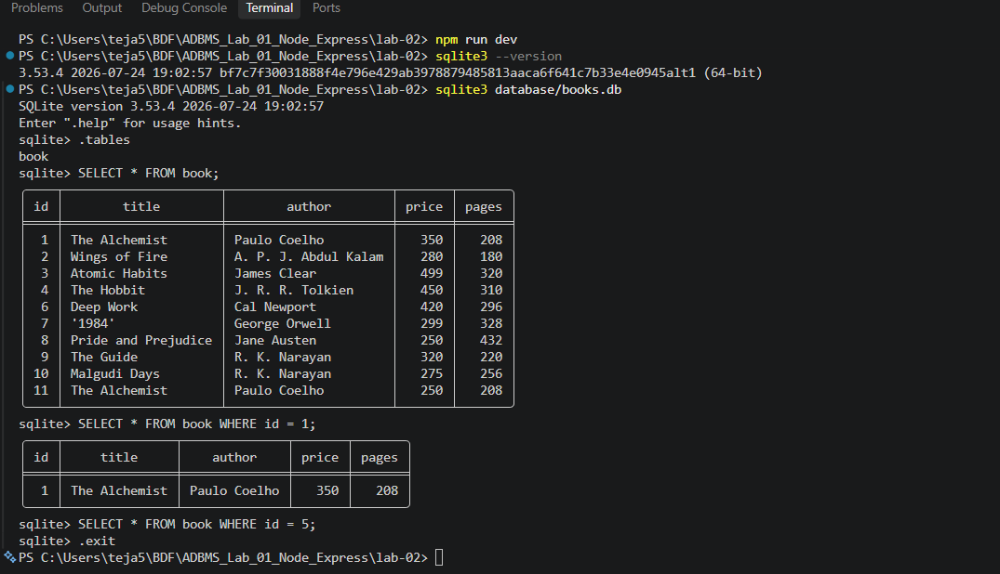